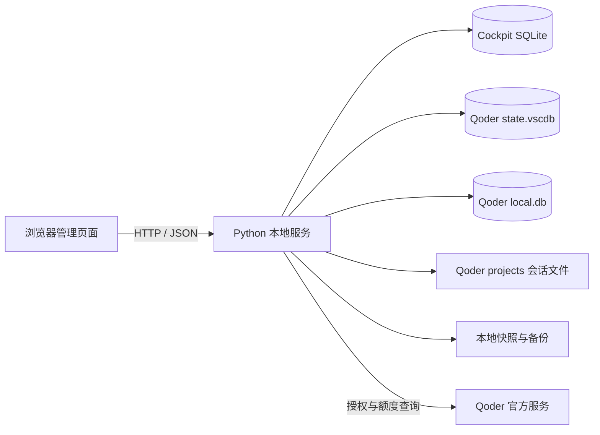

# Qoder Cockpit

Qoder Cockpit 是一个运行在本机的 Qoder 多账号、额度与会话管理工具。它提供浏览器管理页面，通过本地 Python 服务完成账号授权、额度刷新、账号切换，以及 Qoder IDE 历史会话的本地继承。

> [!WARNING]
> 本项目会读取和修改 Qoder 的本地数据库及会话文件，并使用 Qoder 当前的官方授权接口。请先阅读[免责声明](#免责声明)、[安全与隐私](#安全与隐私)和[兼容性与限制](#兼容性与限制)，重要数据请自行保留备份。

## 功能

- 在浏览器页面中管理多个已授权的 Qoder 账号。
- 通过 Qoder 官方 Device Authorization + PKCE 流程添加账号，不接收账号密码。
- 自动刷新账号套餐和 credits，显示剩余百分比、已使用量与总量。
- 在账号卡片中直接切换账号，并自动重新启动 Qoder。
- 切号前保存当前账号的项目会话和全局会话状态。
- 将来源账号的项目会话、Quest/Chat 状态和 IDE 历史列表迁移到目标账号。
- 修改关键数据库前创建本地备份。
- 默认只监听 `127.0.0.1`，账号与会话管理数据保存在本机。

## 运行环境

| 项目 | 要求 |
| --- | --- |
| 操作系统 | Windows 10/11 |
| Python | Python 3.10 或更高版本 |
| Qoder | 已安装 Qoder IDE，至少登录过一次 |
| 浏览器 | 支持现代 JavaScript、CSS Grid 和原生 `dialog` 的浏览器 |

Windows 是当前唯一完整支持的平台，因为 Qoder 凭据的读写依赖 Windows DPAPI 和 Chromium AES-GCM 数据格式。

## 依赖

后端尽量使用 Python 标准库，包括 `http.server`、`sqlite3`、`urllib`、`threading` 和文件系统模块。唯一需要安装的 Python 第三方依赖为：

```text
cryptography>=42,<46
```

前端没有构建步骤，页面为原生 HTML/CSS/JavaScript，已将以下运行时资源固定下载到 `static/vendor/`，页面运行不依赖 CDN：

- Lucide 0.468.0
- Google Fonts：Fira Sans、Fira Code（本地 `woff2` 字体文件）

首次添加账号或刷新额度时仍需要访问 Qoder 官方授权和额度接口；页面框架、图标和字体本身不再依赖外部 CDN。

## 快速开始

### 方式一：启动脚本

克隆或下载项目后，在项目目录双击 `start.cmd`。脚本会检查 `cryptography`，缺少时自动根据 `requirements.txt` 安装，然后启动本地服务并打开浏览器。

关闭服务时双击 `stop.cmd`；它只会停止命令行中明确指向本项目 `server.py` 的 Python 进程。

也可以在 PowerShell 中指定端口：

```powershell
.\start.cmd -Port 9000
```

默认地址：<http://127.0.0.1:8765>

### 方式二：手动启动

```powershell
python -m pip install -r requirements.txt
python .\server.py --host 127.0.0.1 --port 8765
```

当监听地址为 `127.0.0.1` 或 `localhost` 时，服务启动后会自动打开浏览器。

## 使用方式

### 页面导航

页面按工作模式分为四个一级视图，顶部导航随时切换，支持浅色/深色主题：

| 视图 | 地址 | 用途 |
| --- | --- | --- |
| 总览 | `#/overview` | Qoder 运行状态、关键指标、需要处理的事项和快捷入口 |
| 账号 | `#/accounts` | 查看额度、添加/导入/删除账号、切换身份和项目会话快照 |
| 会话 | `#/sessions` | 按工作区查看和操作 IDE 对话与 Quest 任务 |
| 备份 | `#/backups` | 查看、恢复和删除会话备份 |

旧锚点 `#chat-management` 会自动跳转到会话视图，旧书签仍然可用。

高风险操作（恢复、合并、删除会话、删除工作区、删除备份、删除账号记录）统一使用确认弹窗二次确认：弹窗会说明影响范围和自动备份策略；删除工作区还需要先勾选确认框。操作结果以右下角 toast 反馈，成功 4 秒自动消失，错误保留并提供关闭按钮。

### 1. 添加账号

在“账号与额度”区域点击“添加账号”。浏览器会打开 Qoder 官方授权页面，授权完成后，本地后端自动读取账号、套餐与额度信息并加入账号列表。

如果 Qoder 已经登录，也可以点击“导入当前账号”，从本机 `state.vscdb` 读取当前登录身份。项目不提供 JSON 账号导入。

### 2. 查看与刷新额度

账号视图左侧列表显示每个账号的头像、套餐、剩余额度进度和当前/可用状态；点击后在右侧详情中查看完整额度数字、账号 ID、同步时间和可执行操作。

账号卡片显示：

- 剩余 credits 百分比；
- 已使用 credits；
- credits 总量；
- 套餐和最近同步时间。

后端启动约 8 秒后执行第一次自动刷新，此后每 5 分钟刷新一次。页面每 15 秒重新读取本地结果，也可以点击“刷新额度”立即同步。

### 3. 配置会话继承

在账号详情的“切换与继承”区域确认来源账号，并选择是否启用“继承上一账号的 IDE 历史会话”。当前登录账号会自动作为默认来源。同一区域还可以为项目目录保存会话快照。

会话继承包括：

- `~/.qoder/projects` 下的 `transcript/`；
- 项目目录下的 `*.session.execution`；
- `state.vscdb` 中与 Chat/Quest 会话列表相关的状态；
- Qoder `local.db` 中的基础 `chat_session`，以及当前安装中存在的 `local_execution`、`agent_memory` 和任务同步归属。

项目源码、依赖、普通编辑器配置和画布文件不会作为会话内容同步。

### 4. 切换账号

在账号详情中点击“切换到此账号”。当前登录账号不会显示切换按钮。切换完成后页面会带回总览并用 toast 报告保存/恢复/迁移数量；失败时保留在账号视图便于重试。

一次完整切换会按以下顺序执行：

1. 请求 Qoder 正常退出；超时后结束 Qoder 相关进程，避免数据库仍被占用。
2. 备份当前 `state.vscdb`。
3. 保存来源账号的项目会话和全局会话状态快照。
4. 将目标账号凭据写入 Qoder `state.vscdb`。
5. 将来源账号的会话文件和会话状态恢复到当前环境。
6. 备份并更新 Qoder 本地历史会话数据库中的账号归属。
7. 重新启动 Qoder。

### 5. 会话管理

“会话管理”用于维护 Qoder IDE 和 Quest 中按工作区显示的历史记录。IDE 对话直接读取 Qoder 用户目录下全局 `state.vscdb` 的 `lingma.chat.localHistory.<workspace-id>` 键；Quest 任务读取同一数据库的 `aicoding.questTaskListSnapshot`，按任务的 `filePath` 归入工作区。工作区目录中的 `aicoding.chat.views`、`aicoding.chat.tabs` 负责控制 IDE 会话是否可见，页面会用 `IDE` / `Quest` 标签区分两类记录。

#### 查看和搜索对话

1. 启动 Cockpit 后，点击顶部导航的“会话”。
2. 在左侧工作区侧栏选择工作区（窄屏下改为顶部下拉框）。列表会显示工作区名称、短路径和对话数量。
3. 工具栏可按“全部 / IDE / Quest”筛选类型（同时作用于统计和列表），搜索框输入标题关键字有 200 毫秒防抖。
4. 每条记录显示类型、标题、状态（Quest）、时间和上下文数量。点击标题打开右侧详情抽屉；行尾更多菜单可删除单条记录；勾选后可在底部批量栏批量删除。

工作区来自 `%APPDATA%\\Qoder\\User\\workspaceStorage`。如果历史数据库中存在记录、但工作区目录已经不存在，页面仍会列出该工作区 ID，便于备份或清理残留历史。

#### 备份和恢复

- 会话视图工具栏的“备份工作区”只备份当前工作区；备份视图的“备份全部”会把所有工作区保存为一个 JSON 文件。
- 备份文件保存在 `%USERPROFILE%\\.qoder\\cockpit-local\\backups\\chat`，在“备份”视图可查看文件名、工作区、时间和大小。
- 在备份列表点击“恢复”会先弹出确认，说明目标工作区、将覆盖的内容和自动生成的新备份；单工作区备份始终恢复到备份记录中的原工作区，全量备份恢复其中包含的全部工作区，避免因当前页面选择不同而误覆盖其它工作区。
- “恢复最新”会优先查找当前工作区对应的最近备份。
- 恢复、删除、合并等写操作执行前会自动关闭 Qoder，完成后仅在 Qoder 原本运行时自动重启。操作前还会创建 `state.vscdb` 安全副本。

会话管理页的 JSON 备份保存的是历史索引、Quest 任务和显示状态，包含 `chat_history`、`quest_tasks`、`chat_views` 和 `chat_tabs`，不包含完整的 `local.db`、`transcript/` 或 `*.session.execution`。需要跨账号迁移完整会话时，请使用“账号切换”中的“同步全部项目会话”，该流程会额外迁移这些数据。

#### 修复显示、合并和删除（危险操作区）

会话视图底部的“危险操作”区集中放置影响范围较大的操作，均与刷新、导出等低风险按钮分开：

- **修复显示**：根据历史记录补齐工作区的 `chat.views` 和 `chat.tabs`，适用于数据库中有对话但 IDE 列表不显示的情况。
- **合并**：点击后先展示目标工作区选择器，确认弹窗显示源/目标名称、会话数量和“操作前自动备份”说明；按对话 ID 去重，源工作区会被清空，源和目标都会在操作前自动备份，成功后自动跳转到目标工作区。
- **删除选中对话**：批量栏点击删除后二次确认，列出 IDE/Quest 数量和当前工作区；失败时保留选择便于重试。删除前会先自动备份当前工作区并清理失效的显示索引。
- **删除工作区**：弹窗说明删除范围（IDE 历史、Quest 任务和索引）并要求勾选确认框后才可执行；操作前自动备份历史记录，再删除全局历史键和对应的 `workspaceStorage/<workspace-id>` 目录，成功后自动选择下一个可用工作区。执行前请确认目标工作区无未保存内容。
- **导出 MD**：导出所有工作区的标题、时间、会话 ID 和上下文数量，适合检索和归档，不是可直接恢复的完整备份。

建议的安全操作顺序是：先“备份当前工作区”或“备份全部”，再执行删除、合并或恢复；确认 Qoder 已退出并且重要编辑内容已经保存后，再进行大批量操作。

## 设计方案

### 系统结构



### 分层职责

| 层 | 文件或数据 | 职责 |
| --- | --- | --- |
| 页面层 | `static/index.html` | 四视图壳层、导航、抽屉、确认弹窗和 toast 容器 |
| 交互层 | `static/app.js` | 调用本地 API、渲染状态、处理账号和会话操作 |
| 样式层 | `static/styles.css` | 响应式布局、账号卡片、状态和操作反馈 |
| 服务层 | `server.py` | HTTP 服务、OAuth、额度刷新、账号切换与进程控制 |
| 持久化层 | SQLite 与文件快照 | 保存账号索引、会话快照和修改前备份 |

### 账号数据

账号记录存放在 Cockpit 自己的 SQLite 数据库中。每条记录包含稳定账号 ID、邮箱、展示名、套餐、额度快照、更新时间，以及切号需要的 Qoder 授权数据。

前端 API 返回账号信息时会移除内部 `values` 字段，授权材料不会直接渲染到页面。

### 会话继承

Qoder 的历史会话不只存在项目目录中。完整继承需要同时处理三个位置：

1. 项目目录保存对话正文和执行记录。
2. `state.vscdb` 保存 Quest/Chat 列表、标签页布局和当前任务等界面状态。
3. `local.db` 保存 IDE 历史会话正文和账号归属；安装 Quest/Agent 功能后还会包含执行记录、记忆和任务同步表。

切换时先创建快照，再将来源账号的 owner/user 标识重绑定到目标账号。SQLite 更新使用事务执行，失败时回滚。未安装 Quest 时只迁移基础 Chat 表，缺失的扩展表会被跳过，不会导致账号切换停在半完成状态。

## 项目结构

```text
qoder-cockpit/
├─ server.py           # 本地 HTTP 服务与 Qoder 数据操作
├─ requirements.txt    # Python 依赖
├─ start.ps1           # PowerShell 启动入口
├─ start.cmd           # Windows 双击启动入口
├─ stop.cmd             # 停止本项目服务
├─ static/
│  ├─ index.html       # 页面结构
│  ├─ app.js           # 前端交互
│  ├─ styles.css       # 页面样式
│  └─ vendor/          # 本地 Lucide 和字体资源
├─ .gitignore          # 本地数据与生成文件忽略规则
└─ README.md
```

运行数据默认位于 Qoder 用户目录，不应放入项目仓库。

第三方前端资源的版本和许可证见 [`static/vendor/THIRD_PARTY_NOTICES.md`](static/vendor/THIRD_PARTY_NOTICES.md)。

## 数据目录

默认管理目录：

```text
%USERPROFILE%\.qoder\cockpit-local
```

```text
cockpit-local/
├─ cockpit.db                  # 账号、授权材料和额度快照
├─ sessions/
│  └─ <account-id>/            # 按账号保存的项目与 state.vscdb 快照
├─ backups/
│  ├─ state/                   # 切号前的 state.vscdb
│  ├─ session-db/              # local.db 完整备份
│  └─ <timestamp>/             # 项目会话替换前备份
└─ staging/                    # 会话恢复临时目录
```

这些文件可能包含账号标识、访问令牌、邮箱、项目绝对路径和完整对话内容。不要上传、分享或提交到 Git。

## 配置

| 环境变量 | 默认值 | 说明 |
| --- | --- | --- |
| `QODER_ROOT` | `%USERPROFILE%\.qoder` | Qoder 项目及辅助数据根目录 |
| `QODER_COCKPIT_STORE` | `%USERPROFILE%\.qoder\cockpit-local` | Cockpit 数据库、快照和备份目录 |
| `QODER_APP_PATH` | 自动搜索常见安装路径 | Qoder 可执行文件路径 |
| `QODER_SESSION_DB` | 自动搜索 Qoder SharedClientCache | IDE 历史会话 `local.db` 路径 |

PowerShell 示例：

```powershell
$env:QODER_ROOT = "$env:USERPROFILE\.qoder"
$env:QODER_COCKPIT_STORE = "D:\LocalData\qoder-cockpit"
$env:QODER_APP_PATH = "D:\Apps\Qoder\Qoder.exe"
$env:QODER_SESSION_DB = "$env:APPDATA\Qoder\SharedClientCache\cache\db\local.db"
.\start.ps1 -Port 8765
```

## 本地 API

前端只调用同源本地 API。主要接口如下：

| 方法 | 路径 | 用途 |
| --- | --- | --- |
| `GET` | `/api/health` | 服务与 Qoder 运行状态 |
| `GET` | `/api/accounts` | 账号列表和当前账号 |
| `GET` | `/api/projects` | 本地 Qoder 项目会话统计 |
| `POST` | `/api/oauth/start` | 创建官方授权流程 |
| `GET` | `/api/oauth/status` | 查询授权进度 |
| `POST` | `/api/accounts/import-local` | 导入 Qoder 当前登录账号 |
| `POST` | `/api/accounts/refresh` | 刷新账号额度 |
| `POST` | `/api/switch` | 切换账号并按设置继承会话 |
| `POST` | `/api/session/save` | 保存单个项目会话快照 |
| `POST` | `/api/qoder/start` | 启动 Qoder |

这些接口没有用户认证，仅用于本机页面，不应暴露到局域网或公网。

## 免责声明

Qoder Cockpit 是社区维护的非官方工具，与 Qoder、其开发者或服务运营方没有隶属、代理或担保关系。使用本项目产生的任何后果由使用者自行承担，包括但不限于账号状态变化、会话文件损坏、数据丢失、授权失效、服务中断和 Qoder 客户端异常。

本项目会在本机读取、备份和修改 Qoder 的授权数据库、SQLite 数据库、Quest 任务索引以及项目会话文件。请只在你拥有合法访问权限的设备和账号上使用，并在执行账号切换、恢复、合并或删除前保留独立备份。不要把 `cockpit.db`、`state.vscdb`、`local.db`、会话快照或导出文件上传到公共仓库或发送给他人。

本项目不保证绕过 Qoder 的账号权限、credits 限制、服务端策略或风控；也不保证 Qoder 升级后仍能读取或写入相同的数据格式。若 Qoder 官方接口、本地数据库结构或状态键发生变化，请停止批量操作并先核对备份，再决定是否继续使用或适配代码。

## Qoder 版本适配

当前已验证环境：

| 项目 | 已验证版本/环境 |
| --- | --- |
| Qoder IDE | `1.25.1` |
| 操作系统 | Windows 11 专业版（10.0.26200） |
| 已验证功能 | 账号导入、账号切换、IDE 对话、Quest 任务展示、会话备份/恢复和显示索引修复 |

项目没有锁定 Qoder 的安装版本，也没有得到 Qoder 官方的兼容性承诺。除 `1.25.1` 外的版本属于“可能可用但未验证”，尤其是跨版本升级后，以下内部实现可能变化：

- `%APPDATA%\\Qoder\\User\\globalStorage\\state.vscdb` 的 `ItemTable` 结构和状态键；
- `lingma.chat.localHistory.*` 的 IDE 对话格式；
- `aicoding.questTaskListSnapshot` 的 Quest 任务格式；
- `aicoding.chat.views`、`aicoding.chat.tabs` 的显示索引格式；
- `SharedClientCache\\cache\\db\\local.db` 的 Chat/Quest 归属字段。

查看本机 Qoder 版本的方法：在 Qoder 的“帮助 / 关于”中查看，或在 PowerShell 执行：

```powershell
(Get-Item "$env:ProgramFiles\Qoder IDE\Qoder IDE.exe").VersionInfo.ProductVersion
```

升级 Qoder 后，建议先关闭 Qoder，复制 `%USERPROFILE%\\.qoder\\cockpit-local` 和相关 Qoder 数据库，再启动 Cockpit 验证工作区列表、IDE 对话和 Quest 任务数量；确认无误后再执行删除、合并或跨账号迁移。

## 安全与隐私

- 服务默认监听 `127.0.0.1`。不要使用 `--host 0.0.0.0` 对外开放。
- `cockpit.db` 包含可用于恢复登录状态的授权材料，不是可公开分享的数据文件。
- 账号授权和额度查询会把授权令牌发送到 Qoder 官方接口；项目本身没有其它后端或遥测服务。
- 页面框架、图标和字体均从项目内的 `static/vendor/` 加载，不会因 CDN 不可用而缺少这些资源。
- 会话快照和备份可能包含完整对话、代码片段、项目路径和账号标识。
- 仓库的 `.gitignore` 已排除常见数据库、快照、缓存和本地环境文件，但提交前仍应检查 `git status`。
- 删除页面中的账号只删除 Cockpit 本地账号记录，不会注销 Qoder 账号。

## 兼容性与限制

- 当前完整验证版本为 Qoder IDE `1.25.1`；其它版本请按[版本适配](#qoder-版本适配)章节自行验证。
- OAuth 接口、本地 SQLite 表结构和状态键属于 Qoder 当前实现细节，Qoder 升级后可能需要适配。
- 工具保证的是本机账号状态与本地会话数据迁移，不能绕过 Qoder 服务端的账号权限、credits 或任务策略。
- 账号授权过期后需要重新执行官方授权。
- 强制关闭 Qoder 可能影响尚未保存的编辑内容，切号前应先保存工作。

## 开发

项目没有前端打包流程。修改 `static/` 文件后刷新浏览器即可；修改 `server.py` 后需要重启本地服务。

基础静态检查：

```powershell
python -m py_compile .\server.py
node --check .\static\app.js
```

Node.js 只用于可选的 JavaScript 语法检查，不是运行依赖。

## 发布前检查

```powershell
git status --short
git ls-files
git grep -n -i -E "token|password|secret|authorization|bearer"
```

重点确认未提交以下内容：

- `cockpit.db`、`state.vscdb`、`local.db` 及其 WAL/SHM 文件；
- `cockpit-local/`、`sessions/`、`backups/`；
- `.env`、日志、缓存和浏览器截图；
- 真实账号邮箱、访问令牌、项目绝对路径和对话内容。

公开发布前还应根据你的授权意图选择并添加合适的 `LICENSE` 文件。
