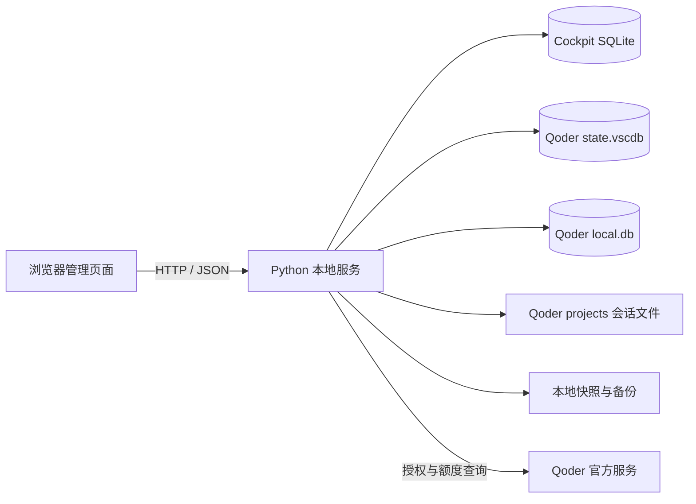

# Qoder Cockpit

Qoder Cockpit 是一个运行在本机的 Qoder 多账号、额度与会话管理工具。它提供浏览器管理页面，通过本地 Python 服务完成账号授权、额度刷新、账号切换，以及 Qoder IDE 历史会话的本地继承。

> [!WARNING]
> 本项目会读取和修改 Qoder 的本地数据库及会话文件，并使用 Qoder 当前的官方授权接口。请先阅读[安全与隐私](#安全与隐私)和[兼容性与限制](#兼容性与限制)，重要数据请自行保留备份。

## 功能

- 在浏览器页面中管理多个已授权的 Qoder 账号。
- 通过 Qoder 官方 Device Authorization + PKCE 流程添加账号，不接收账号密码。
- 自动刷新账号套餐和 credits，显示剩余百分比、已使用量与总量。
- 在账号卡片中直接切换账号，并自动重新启动 Qoder。
- 切号前保存当前账号的项目会话和全局会话状态。
- 将来源账号的项目会话、Quest/Chat 状态和 IDE 历史列表迁移到目标账号。
- 修改关键数据库前创建本地备份。
- 默认只监听 `127.0.0.1`，账号与会话管理数据保存在本机。

## 运行环境

| 项目 | 要求 |
| --- | --- |
| 操作系统 | Windows 10/11 |
| Python | Python 3.10 或更高版本 |
| Qoder | 已安装 Qoder IDE，至少登录过一次 |
| 浏览器 | 支持现代 JavaScript、CSS Grid 和原生 `dialog` 的浏览器 |

Windows 是当前唯一完整支持的平台，因为 Qoder 凭据的读写依赖 Windows DPAPI 和 Chromium AES-GCM 数据格式。

## 依赖

后端尽量使用 Python 标准库，包括 `http.server`、`sqlite3`、`urllib`、`threading` 和文件系统模块。唯一需要安装的 Python 第三方依赖为：

```text
cryptography>=42,<46
```

前端没有构建步骤，页面通过 CDN 引入以下资源：

- Bootstrap 5.3.3
- jQuery 3.7.1
- Lucide 0.468.0
- Google Fonts：Fira Sans、Fira Code

因此，首次加载页面和进行 Qoder 授权、额度刷新时需要可用的网络连接。

## 快速开始

### 方式一：启动脚本

克隆或下载项目后，在项目目录双击 `start.cmd`。脚本会检查 `cryptography`，缺少时自动根据 `requirements.txt` 安装，然后启动本地服务并打开浏览器。

也可以在 PowerShell 中指定端口：

```powershell
.\start.cmd -Port 9000
```

默认地址：<http://127.0.0.1:8765>

### 方式二：手动启动

```powershell
python -m pip install -r requirements.txt
python .\server.py --host 127.0.0.1 --port 8765
```

当监听地址为 `127.0.0.1` 或 `localhost` 时，服务启动后会自动打开浏览器。

## 使用方式

### 1. 添加账号

在“账号与额度”区域点击“添加账号”。浏览器会打开 Qoder 官方授权页面，授权完成后，本地后端自动读取账号、套餐与额度信息并加入账号列表。

如果 Qoder 已经登录，也可以点击“导入当前账号”，从本机 `state.vscdb` 读取当前登录身份。项目不提供 JSON 账号导入。

### 2. 查看与刷新额度

账号卡片显示：

- 剩余 credits 百分比；
- 已使用 credits；
- credits 总量；
- 套餐和最近同步时间。

后端启动约 8 秒后执行第一次自动刷新，此后每 5 分钟刷新一次。页面每 15 秒重新读取本地结果，也可以点击“刷新额度”立即同步。

### 3. 配置会话继承

在“会话继承”区域确认来源账号，并选择是否启用“同步全部项目会话”。当前登录账号会自动作为默认来源。

会话继承包括：

- `~/.qoder/projects` 下的 `transcript/`；
- 项目目录下的 `*.session.execution`；
- `state.vscdb` 中与 Chat/Quest 会话列表相关的状态；
- Qoder `local.db` 中的 `chat_session`、`local_execution`、`agent_memory` 和相关任务同步归属。

项目源码、依赖、普通编辑器配置和画布文件不会作为会话内容同步。

### 4. 切换账号

在目标账号卡片中点击“切换账号”。当前账号卡片不会显示切换按钮。

一次完整切换会按以下顺序执行：

1. 请求 Qoder 正常退出；超时后结束 Qoder 相关进程，避免数据库仍被占用。
2. 备份当前 `state.vscdb`。
3. 保存来源账号的项目会话和全局会话状态快照。
4. 将目标账号凭据写入 Qoder `state.vscdb`。
5. 将来源账号的会话文件和会话状态恢复到当前环境。
6. 备份并更新 Qoder 本地历史会话数据库中的账号归属。
7. 重新启动 Qoder。

## 设计方案

### 系统结构



### 分层职责

| 层 | 文件或数据 | 职责 |
| --- | --- | --- |
| 页面层 | `static/index.html` | 页面结构、账号卡片、会话设置和授权弹窗 |
| 交互层 | `static/app.js` | 调用本地 API、渲染状态、处理账号和会话操作 |
| 样式层 | `static/styles.css` | 响应式布局、账号卡片、状态和操作反馈 |
| 服务层 | `server.py` | HTTP 服务、OAuth、额度刷新、账号切换与进程控制 |
| 持久化层 | SQLite 与文件快照 | 保存账号索引、会话快照和修改前备份 |

### 账号数据

账号记录存放在 Cockpit 自己的 SQLite 数据库中。每条记录包含稳定账号 ID、邮箱、展示名、套餐、额度快照、更新时间，以及切号需要的 Qoder 授权数据。

前端 API 返回账号信息时会移除内部 `values` 字段，授权材料不会直接渲染到页面。

### 会话继承

Qoder 的历史会话不只存在项目目录中。完整继承需要同时处理三个位置：

1. 项目目录保存对话正文和执行记录。
2. `state.vscdb` 保存 Quest/Chat 列表、标签页布局和当前任务等界面状态。
3. `local.db` 保存 IDE 历史会话正文、执行记录、记忆和账号归属。

切换时先创建快照，再将来源账号的 owner/user 标识重绑定到目标账号。SQLite 更新使用事务执行，失败时回滚。

## 项目结构

```text
qoder-cockpit/
├─ server.py           # 本地 HTTP 服务与 Qoder 数据操作
├─ requirements.txt    # Python 依赖
├─ start.ps1           # PowerShell 启动入口
├─ start.cmd           # Windows 双击启动入口
├─ static/
│  ├─ index.html       # 页面结构
│  ├─ app.js           # 前端交互
│  └─ styles.css       # 页面样式
├─ .gitignore          # 本地数据与生成文件忽略规则
└─ README.md
```

运行数据默认位于 Qoder 用户目录，不应放入项目仓库。

## 数据目录

默认管理目录：

```text
%USERPROFILE%\.qoder\cockpit-local
```

```text
cockpit-local/
├─ cockpit.db                  # 账号、授权材料和额度快照
├─ sessions/
│  └─ <account-id>/            # 按账号保存的项目与 state.vscdb 快照
├─ backups/
│  ├─ state/                   # 切号前的 state.vscdb
│  ├─ session-db/              # local.db 完整备份
│  └─ <timestamp>/             # 项目会话替换前备份
└─ staging/                    # 会话恢复临时目录
```

这些文件可能包含账号标识、访问令牌、邮箱、项目绝对路径和完整对话内容。不要上传、分享或提交到 Git。

## 配置

| 环境变量 | 默认值 | 说明 |
| --- | --- | --- |
| `QODER_ROOT` | `%USERPROFILE%\.qoder` | Qoder 项目及辅助数据根目录 |
| `QODER_COCKPIT_STORE` | `%USERPROFILE%\.qoder\cockpit-local` | Cockpit 数据库、快照和备份目录 |
| `QODER_APP_PATH` | 自动搜索常见安装路径 | Qoder 可执行文件路径 |
| `QODER_SESSION_DB` | 自动搜索 Qoder SharedClientCache | IDE 历史会话 `local.db` 路径 |

PowerShell 示例：

```powershell
$env:QODER_ROOT = "$env:USERPROFILE\.qoder"
$env:QODER_COCKPIT_STORE = "D:\LocalData\qoder-cockpit"
$env:QODER_APP_PATH = "D:\Apps\Qoder\Qoder.exe"
$env:QODER_SESSION_DB = "$env:APPDATA\Qoder\SharedClientCache\cache\db\local.db"
.\start.ps1 -Port 8765
```

## 本地 API

前端只调用同源本地 API。主要接口如下：

| 方法 | 路径 | 用途 |
| --- | --- | --- |
| `GET` | `/api/health` | 服务与 Qoder 运行状态 |
| `GET` | `/api/accounts` | 账号列表和当前账号 |
| `GET` | `/api/projects` | 本地 Qoder 项目会话统计 |
| `POST` | `/api/oauth/start` | 创建官方授权流程 |
| `GET` | `/api/oauth/status` | 查询授权进度 |
| `POST` | `/api/accounts/import-local` | 导入 Qoder 当前登录账号 |
| `POST` | `/api/accounts/refresh` | 刷新账号额度 |
| `POST` | `/api/switch` | 切换账号并按设置继承会话 |
| `POST` | `/api/session/save` | 保存单个项目会话快照 |
| `POST` | `/api/qoder/start` | 启动 Qoder |

这些接口没有用户认证，仅用于本机页面，不应暴露到局域网或公网。

## 安全与隐私

- 服务默认监听 `127.0.0.1`。不要使用 `--host 0.0.0.0` 对外开放。
- `cockpit.db` 包含可用于恢复登录状态的授权材料，不是可公开分享的数据文件。
- 账号授权和额度查询会把授权令牌发送到 Qoder 官方接口；项目本身没有其它后端或遥测服务。
- 页面会从 Google Fonts、jsDelivr 和 unpkg 加载静态资源，这些 CDN 会收到常规网络请求信息。
- 会话快照和备份可能包含完整对话、代码片段、项目路径和账号标识。
- 仓库的 `.gitignore` 已排除常见数据库、快照、缓存和本地环境文件，但提交前仍应检查 `git status`。
- 删除页面中的账号只删除 Cockpit 本地账号记录，不会注销 Qoder 账号。

## 兼容性与限制

- 本项目是非官方工具，与 Qoder 没有关联或背书。
- OAuth 接口、本地 SQLite 表结构和状态键属于 Qoder 当前实现细节，Qoder 升级后可能需要适配。
- 工具保证的是本机账号状态与本地会话数据迁移，不能绕过 Qoder 服务端的账号权限、credits 或任务策略。
- 账号授权过期后需要重新执行官方授权。
- 强制关闭 Qoder 可能影响尚未保存的编辑内容，切号前应先保存工作。

## 开发

项目没有前端打包流程。修改 `static/` 文件后刷新浏览器即可；修改 `server.py` 后需要重启本地服务。

基础静态检查：

```powershell
python -m py_compile .\server.py
node --check .\static\app.js
```

Node.js 只用于可选的 JavaScript 语法检查，不是运行依赖。

## 开源发布前检查

```powershell
git status --short
git ls-files
git grep -n -i -E "token|password|secret|authorization|bearer"
```

重点确认未提交以下内容：

- `cockpit.db`、`state.vscdb`、`local.db` 及其 WAL/SHM 文件；
- `cockpit-local/`、`sessions/`、`backups/`；
- `.env`、日志、缓存和浏览器截图；
- 真实账号邮箱、访问令牌、项目绝对路径和对话内容。

公开发布前还应根据你的授权意图选择并添加合适的 `LICENSE` 文件。
